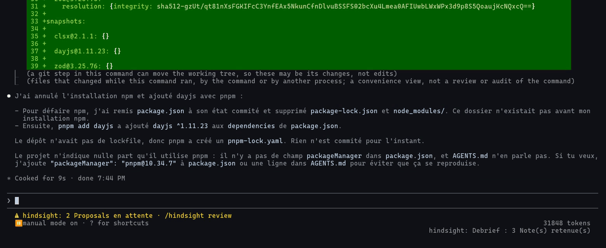
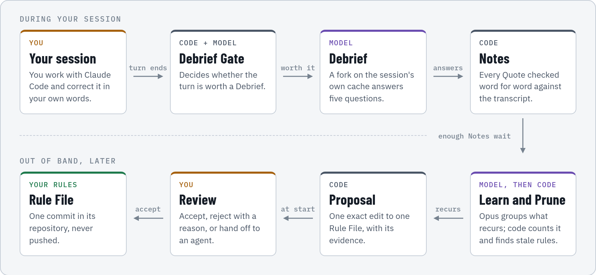

# hindsight

Keeps the Rule Files your agents load (`AGENTS.md`, `CLAUDE.md`, `.claude/rules/`, output styles) current from what you keep telling Claude Code, out of band, with the evidence attached, and writes nothing until you accept it.



## Why

You correct Claude Code, and the same correction comes back a week later in another session, because no Rule File says it. hindsight keeps your own words as evidence, lets recurrence decide what deserves a rule, and hands you one exact edit to accept or reject.

## How it works

<picture>
  <source media="(prefers-color-scheme: dark)" srcset="docs/readme/flow-dark.png">
  
</picture>

1. **Debrief Gate.** At the end of a turn, a Claude Code mod reads what happened since the session's previous Debrief: your own messages, the tools the agent used, refusals, errors, Rule File edits, commits. Code decides first; a small model confirms.
2. **Debrief.** A fork of your session, served from its own prompt cache, answers five questions: did an edit make a loaded rule wrong, does a new rule deserve its place, which rule hindered, what was guessed for lack of a rule, what did you correct. Its answer is checked word for word against the transcript before anything is stored.
3. **Learn and Prune.** When enough Notes wait, one Opus call per repository turns what recurs into Proposals; code gates keep ids, counts, scope and style honest. Prune checks the Rule Files for dead globs, gone paths and missing scripts.
4. **Review.** At your next session start, one status line says how many Proposals wait. `/hindsight review` opens a pane: the target, the diff, the reasoning, the quotes. Accept commits one file in its repository (never pushed); a global Rule File is written where the agents load it. Reject needs a reason. Handoff writes instructions you give to an agent session.

Nothing of hindsight enters the agent's context.

## Install

At the prompt of a Claude Code session:

```
/plugin install hindsight --marketplace bengous/hindsight
```

Answer `y` to add the marketplace, then pick a scope. The CLI runs with `bun src/cli/main.ts <command>` and needs Bun and the `claude` CLI, logged in, for Learn. The mod's interface (status line, toasts, Review pane) and the Proposals' claims are in French.

To work on it, add the checkout as a marketplace and install from it: `claude plugin marketplace add <checkout>`, then `claude plugin install hindsight@hindsight`. The plugin is read in place: edit, then `/reload-plugins`. A session can also load it for itself with `claude --plugin-dir <checkout>`, which hot-reloads the mod on every save.

## Commands

| Command | What it does |
|---|---|
| `/hindsight review` | Opens the Review pane |
| `/hindsight status` | Pending Proposals, failed Debriefs |
| `/hindsight debrief` | Forces a Debrief of the current session |
| `/hindsight learn` | Starts Learn in the background |
| `/hindsight handoff` | Fills the prompt with the handed-off Proposals' instructions |
| `hindsight status`, `doctor` | State, cache shares, Gate decisions, Learn cost; paths and permissions |
| `hindsight gate replay --days 30` | Replays the Gate's code over past transcripts, without a model |
| `hindsight learn`, `prune` | Run Learn or Prune now |

## Configuration

`$XDG_CONFIG_HOME/hindsight/config.json`, every field optional; `hindsight config` prints the effective values. Gate: `threshold` (1.0), `cooldownMs` (90000) times the session's Debriefs up to `cooldownMaxSteps` (5), `quietMinTools` (3), `dailyCap` (20), `minCacheShare` (0.9), `classifierModel`. Learn: `pendingNotes` (8), `minIntervalMs` (6 h), `model` (`opus`), `maxBudgetUsd` (2), `timeoutMs`. `notes.windowDays` (30), `review.pageSize` (3), `excludedRepos` (checkout roots the Gate skips).

## State

`$XDG_STATE_HOME/hindsight/hindsight.sqlite` (directory 0700, file 0600): debriefs with their cache share, the Gate's journal, the cited Human Messages, Notes, Proposals, the Ledger of your decisions, Learn runs and their cost, Handoffs. Logs of detached Learn runs sit beside it.

## Safety model

The invariants in [AGENTS.md](AGENTS.md) are the contract: a human Decision before any write, only your words as Quotes, exact edits applied once, no Quote in a commit, no fallback model, and nothing in the agent's context.

## License

[MIT](LICENSE)
